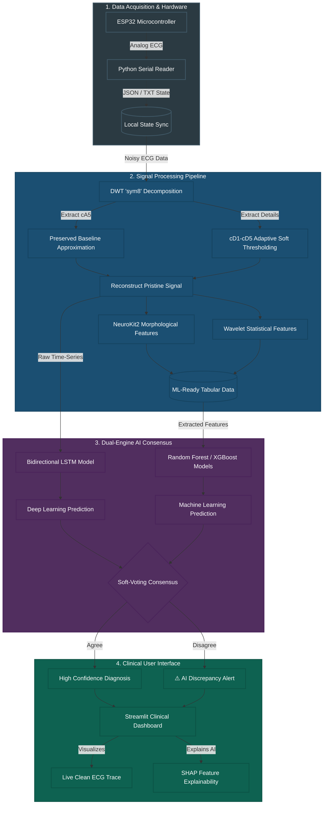
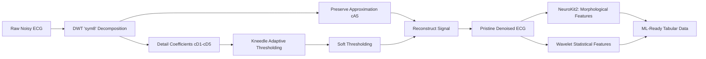
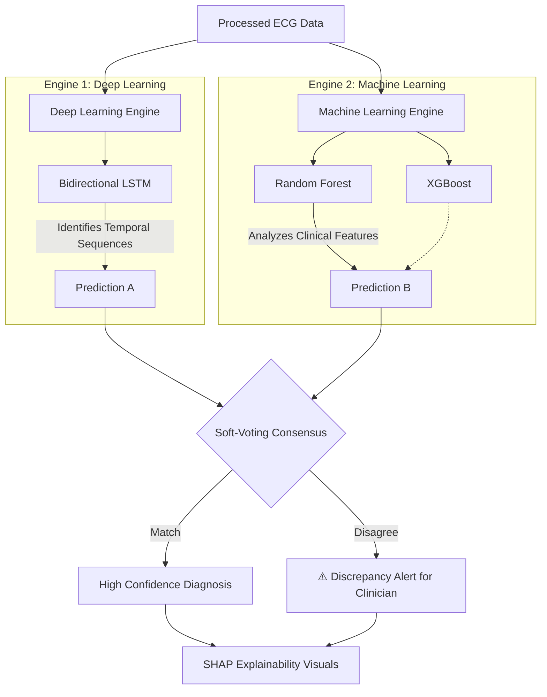

# 🫀 CardioVision: Clinical ECG Diagnostic System

> [!NOTE]
> **Project Overview:** CardioVision is a comprehensive, clinical-grade diagnostic system designed to acquire, process, and analyze electrocardiogram (ECG) data in real-time. The primary objective is to provide high-precision classification of cardiac conditions (such as ischemia) by combining robust hardware data acquisition with a sophisticated **Dual-Engine AI** architecture.

---

## 🏗️ 1. High-Level System Architecture

The project seamlessly integrates hardware sensors, real-time data streaming, AI inference, and a clinical UI.

---

## 📡 2. Signal Processing Pipeline (`pipeline.py`)

A critical component of CardioVision is transforming noisy clinical data into pristine signals while explicitly preserving baseline cardiovascular morphologies.

### Key Technical Details:
* **Adaptive Wavelet Denoising**: Employs Discrete Wavelet Transform (DWT) using the `sym8` wavelet. Applies adaptive, knee-point soft thresholding to detail coefficients to suppress high-frequency noise (e.g., muscle artifacts).
* **Baseline Preservation**: Explicitly preserves the low-frequency approximation (`cA5`) to maintain the true baseline wander and foundational signal morphology.
* **Morphological Feature Extraction**: Utilizes `neurokit2` for peak detection and wave delineation to extract critical clinical metrics (e.g., QRS duration, ST-segment deviation, T-wave amplitude, QT interval).

---

## 🧠 3. Dual-Engine AI Consensus

To ensure high diagnostic reliability and avoid false positives, CardioVision combines two different AI paradigms.

### Engine Breakdown:
* **Deep Learning Engine**: A Bidirectional LSTM model (`lstm_model.pth`) analyzes the raw, temporal sequential ECG signal to capture complex time-series dependencies.
* **Machine Learning Engine**: Traditional, highly interpretable classifiers (`rf_model.pkl`, `xgb_model.json`) are trained on tabular morphological features extracted by the pipeline.
* **Discrepancy Alerts**: If the two engines disagree, the soft-voting system highlights the discrepancy for manual clinical review, ensuring safety.

---

## 💾 4. Data Infrastructure & Scale

> [!TIP]
> **Data Scale:** The project evolved from a 1,000-sample prototype to a highly robust **72,000-row balanced dataset** (`ecg_dataset_72k_balanced.csv`) to improve generalization across various patient profiles.

* **Batch Processing**: Scripts like `process_massive_dataset.py` process large-scale data in memory-efficient chunks.
* **Data Augmentation**: Employs Generative Adversarial Networks (`train_gan.py`) to synthesize additional data and balance underrepresented disease classes.
